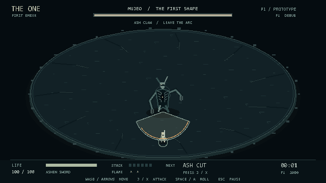

# THE ONE 최초의 불씨

최초의 인간이 태초의 악과 단 한 번의 전쟁을 치르는 2D 도트 액션 게임의 개발 기준 문서다. 하나의 경기장, 하나의 보스, 다섯 페이즈를 끝까지 돌파하는 고난도 1인 레이드이며, 매 도전의 무기와 각인 선택으로 공략이 달라진다.

가제는 **THE ONE 최초의 불씨**. 플레이어는 처음부터 신이 아니다. 적에게서 떨어져 나온 세계의 성질을 자신의 공격으로 바꾸면서, 훗날 신이라고 불릴 존재가 된다.

**M1·M2 플레이 가능한 시제품 구현 완료.** 잿빛 검, 비기, 화염 기운과 공명, 무저 P1의 세 패턴, 사망·완료·재도전을 사용할 수 있다. 2026년 10월 16일 기준이며 최종 도트 아트 대신 임시 도형을 사용한다. 전투 수치는 첫 플레이테스트를 위한 초깃값이다.



## 실행

프로젝트 폴더에서 PowerShell로 실행한다. 준비된 엔진은 **Godot 4.5.2 stable**이다.

```powershell
powershell -ExecutionPolicy Bypass -File tools\run_game.ps1
```

시작 화면에서 J 또는 Enter를 누른다. 기본 창은 1280×720이며 전투 논리 해상도는 640×360이다. 편집기를 열려면 같은 명령 뒤에 `-Editor`를 붙인다.

| 행동 | 키보드 | 게임패드 |
|---|---|---|
| 이동 | WASD / 방향키 | 왼쪽 스틱 |
| 공격 | J, 누를 때마다 1회 | X / 서쪽 얼굴 버튼 |
| 회피 | Space / K | A / 남쪽 얼굴 버튼 |
| 일시정지 | Esc | Start |
| 메뉴 선택과 확인 | 위·아래 / J·Enter | 스틱 / 서쪽 얼굴 버튼 |
| 빠른 재도전 | R | 결과 메뉴에서 선택 |
| 판정 디버그 | F1 | 키보드 사용 |

공격 스택 6개는 다음 공격을 비기로, 화염 획득은 다음 2회를 화염 공격으로 바꾼다. 둘 다 준비되면 공명이다. 기운을 획득한 뒤에는 새로 공격키를 눌러야 한다. P1 처치 시 시제품은 종료된다.

엔진 실행파일은 `.tools/godot/`에 준비되어 있다. 다른 컴퓨터로 소스만 옮긴 경우 Godot 4.5.2 Standard를 준비하고 `-GodotPath '엔진 실행파일 경로'`로 지정할 수 있다. 런처는 캐시와 엔진 로그를 프로젝트의 `.tools/runtime-data/`에 격리하며 영구 저장 기능은 구현하지 않는다.

## 검증 실행

```powershell
powershell -ExecutionPolicy Bypass -File tools\test_game.ps1
powershell -ExecutionPolicy Bypass -File tools\test_game.ps1 -TestScript res://tests/playthrough.gd
powershell -ExecutionPolicy Bypass -File tools\test_game.ps1 -TestScript res://tests/scene_integration.gd
```

기본 명령은 전투 규칙 검증, 두 번째는 정상 체력·공격력과 이동·공격·회피 입력으로 5개 시드를 완주하는 검증, 세 번째는 실제 장면의 입력·일시정지·결과·재도전 연결 검증이다. 실행 전 프로젝트를 import하며 스크립트 오류가 있으면 실패 코드로 종료한다.

현재 구현과 확인한 내용, 알려진 제한은 [시제품 개발 결과](docs/04_PROTOTYPE_STATUS.md)를 참고한다.

## 문서 읽는 순서

1. [게임 설계서](docs/01_GAME_DESIGN.md) — 콘셉트, 서사, 조작, 무기, 속성, 반복 도전, 화면과 사운드.
2. [보스 설계서](docs/02_BOSS_DESIGN.md) — 다섯 페이즈의 패턴, 대응법, 공격 선택 규칙, 전환 처리.
3. [개발 인계서](docs/03_IMPLEMENTATION_HANDOFF.md) — 상태와 데이터 구조, 구현 순서, 수락 기준, 개발 모델에 전달할 프롬프트.
4. [시제품 개발 결과](docs/04_PROTOTYPE_STATUS.md) — 실제 실행과 검증 결과, M3 인계 내용.

## 반드시 유지할 게임의 중심

- 전투 스테이지 하나와 보스 개체 하나. 페이즈가 바뀌어도 같은 전쟁을 계속한다.
- 이동, 공격, 회피만으로 전투한다. 무기와 기운은 다음 공격의 성질을 바꾼다.
- 피해를 주기 위해 위험한 거리를 드나들고, 보스가 흘린 힘을 획득할 동선을 판단한다.
- 어려움은 예고를 읽고 올바르게 대응하는 데서 나온다. 무작위 즉사나 반복 노가다로 난도를 만들지 않는다.
- 사망하면 도전을 처음부터 시작한다. 도달한 페이즈는 같은 경기장의 별도 연습 모드에서 익힐 수 있다.

## 개발 시작점

현재 구현은 **Godot 4.5.2와 GDScript, Windows 싱글플레이**다. 실제 등각 좌표 변환 없이 2D 지면 좌표와 비스듬한 도트 표현을 사용한다.

첫 개발 목표인 도형 그래픽의 검 하나, 보스 1페이즈, 화염 기운 하나를 구현했다. 다음은 M3의 P2~P5, 페이즈 전환과 연습 모드다. [개발 인계서](docs/03_IMPLEMENTATION_HANDOFF.md)의 M1·M2 전달 프롬프트는 첫 구현의 기록이며, 후속 작업에는 현재 코드를 읽고 M3부터 이어가도록 범위를 지정한다.

## 문서의 우선순위

게임의 범위와 플레이 규칙은 게임 설계서, 개별 보스 패턴의 수치와 선택 규칙은 보스 설계서, 동일 틱 사건 처리와 개발 수락 조건은 개발 인계서가 기준이다. 구현하면서 수치를 바꾸면 해당 원본 문서도 함께 바꾼다. 미래 확장 아이디어를 초기 필수 기능으로 확대하지 않는다.
