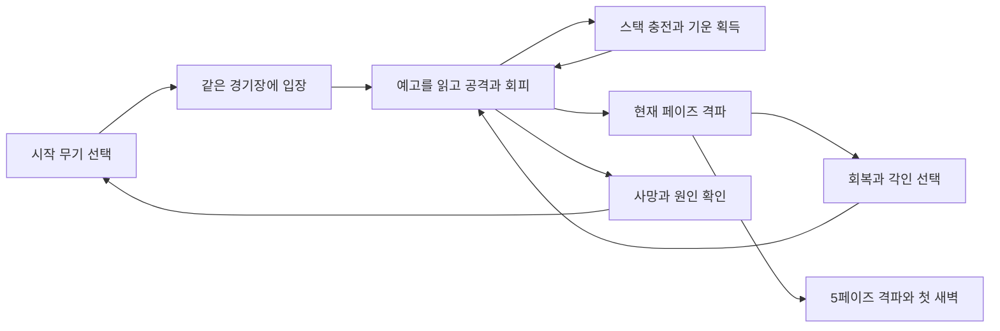

# THE ONE 게임 설계서

## 게임의 약속

**아직 신이 없던 시대, 최초의 인간이 태초의 악에게서 힘을 빼앗아 단 하나의 전투로 새벽을 만든다.**

가제는 **THE ONE 최초의 불씨**다. 어둡고 축축한 도트 세계에서 거대한 적의 몸짓을 읽고, 한두 번 공격한 뒤 빠져나오며, 떨어진 기운을 주울 순간을 찾는 게임이다. 버튼 수는 적지만 매 순간 거리, 방향, 공격의 확정 시간, 다음 공격의 종류를 판단한다.

완전 무작위 던전 대신 **한 전투 안에서 빌드가 만들어지는 로그라이크 구조**를 채택한다. 같은 보스의 다섯 면모를 배우는 숙련과, 도전마다 달라지는 무기 배치·각인 선택이 반복 플레이를 만든다.

### 기본 사양

| 항목 | 설계 결정 |
|---|---|
| 장르 | 실시간 2D 액션, 단일 보스 레이드, 도전 단위 빌드 초기화 |
| 플랫폼 | 우선 Windows PC, 키보드와 게임패드 |
| 시점 | 비스듬한 위쪽 시점의 2D 도트. 지면 판정은 화면 X/Y 평면 |
| 콘텐츠 | 경기장 1개, 보스 1개, 페이즈 5개, 무기 5종, 속성 4종, 각인 12종 |
| 전투 입력 | 이동, 공격, 회피. 일시정지와 메뉴 조작은 별도 |
| 성공한 도전 길이 | 우선 8~12분을 목표로 조율 |
| 난도 | 일반 공격 약 3~4회 피격이 치명적인 수준. 실수 후 학습 가능해야 함 |
| 진행 | 사망 시 장비·각인·전투 자원 초기화. 발견과 연습 해금 유지 |
| 구현 기준 | Godot 4 계열 안정판 + GDScript를 기본안으로 채택 |

시간, 피해량, 이동량, 성공률 목표는 검증된 밸런스가 아닌 시작 가설이다. 조작 수, 보스 수, 다섯 페이즈, 공정한 예고는 고정하고 수치는 테스트로 조절한다.

### 검토한 방향과 선택

| 방향 | 얻는 것 | 비용 또는 문제 | 판단 |
|---|---|---|---|
| 횡스크롤 결투 | 제작 범위와 거리 판정이 단순함 | 기운을 줍는 우회 동선과 공간 레이드가 약해짐 | 채택하지 않음 |
| 넓은 등각 경기장과 완전 자유 카메라 | 탐색과 거대함 | 화면 밖 공격, 도트 제작, 시야 관리 비용이 큼 | 채택하지 않음 |
| 한 화면의 비스듬한 2D 경기장 | 보스·예고·획득 경로를 동시에 읽음 | 깊이감을 배경과 애니메이션으로 만들어야 함 | 채택 |

## 세계와 이야기

### 최초의 인간

주인공은 이름 없는 첫 인간이다. 낡은 천과 재로 몸을 감싸고, 아직 의미가 없는 돌조각을 무기로 든다. 신성한 갑옷이나 완성된 문명의 장비를 착용하지 않는다.

처음 얻는 불은 의지, 서리는 경계, 번개는 움직임, 공허는 사라지는 것의 흔적을 뜻한다. 원초의 악은 생길 수 있는 모든 세계를 삼키고 있다. 인간은 공격할 때마다 그 안에 갇힌 가능성을 밖으로 꺼낸다. 적의 힘을 가져온다는 행동 자체가 창세가 된다.

### 태초의 악 무저

보스의 호칭은 **무저**, 즉 바닥 없는 존재다. 뿔 달린 군주보다 덜 인간적이어야 한다. 검은 뼈, 접히는 팔, 가슴의 빈 공간으로 구성되며 신체의 일부가 그림자와 구별되지 않는다. 초반에는 인간보다 서너 배 큰 형상으로 싸우고, 후반에는 뒤의 거대한 실루엣과 전장의 잔향이 본질을 드러낸다.

실제 공격 대상은 끝까지 같은 개체다. 분리된 소환수, 잡몹 웨이브, 두 번째 보스를 넣지 않는다. 잔향은 공격 판정이며 별도의 적 AI나 체력을 갖지 않는다.

### 반복 도전의 이유

플레이어가 죽을 때마다 아직 태어나지 않은 세계가 다시 접힌다. 최초의 불씨만 이전 도전의 감각을 기억한다. 반복은 여러 시대의 전쟁이 아니라, 하나의 최초 전투가 성립하기까지의 실패한 가능성들이다.

시작 문구는 “아직, 첫날은 오지 않았다.” 정도로 짧게 제시한다. 반복 도전에서는 즉시 생략한다. 페이즈 사이에는 한 줄의 짧은 문장과 몸의 변화만 보여 주고 장문의 대사를 넣지 않는다.

### 결말

무저를 쓰러뜨린 뒤 플레이어가 서 있던 자리에 첫 햇빛이 생긴다. 인물의 고유명 대신 “그들은 나중에, 그를 신이라 불렀다.”라는 문장으로 끝낸다. 승천은 전투 중 축적된 빛의 흔적으로 미리 보여 준다.

초기 버전의 결말은 하나다. 무기와 가장 많이 쓴 속성에 따라 엔딩 실루엣과 기록의 칭호만 달라진다. 숨겨진 여섯 번째 페이즈나 추가 필수 보스는 없다.

## 한 도전의 흐름



1. 발견한 시작 무기를 선택한다. 최초 도전은 검으로 시작한다.
2. 입장 시 네 무기 제단의 아이콘을 보고 이번 도전의 교체 동선을 파악한다.
3. 보스를 공격해 무기 스택을 쌓고, 체력 구간마다 튕겨 나오는 속성 기운을 얻는다.
4. 페이즈를 끝내면 체력을 15 회복한다. P1·P2·P3 종료 후에는 각인 하나를 고른다.
5. P4 종료 후에는 회복과 짧은 연출만 거쳐 P5로 진입한다.
6. 사망하면 원인과 최고 도달 지점을 보고 같은 시드 재도전 또는 새 도전을 고른다.

정식 도전에는 페이즈 체크포인트가 없다. 재도전 확인 뒤 조작 가능해질 때까지 3초 이내를 목표로 한다. 메뉴와 각인 선택 시간은 전투 시간 기록에 포함하지 않는다.

## 조작과 플레이어

| 행동 | 키보드 기본값 | 게임패드 기본값 | 규칙 |
|---|---|---|---|
| 이동 | WASD 또는 방향키 | 왼쪽 스틱 | 키보드 8방향, 스틱 자유 방향. 대각 속도 정규화 |
| 공격 | J | X 또는 서쪽 얼굴 버튼 | 새로운 누름 1회에 행동 1회 |
| 회피 | Space 또는 K | A 또는 남쪽 얼굴 버튼 | 입력 방향으로 낮게 구르며 미끄러짐 |
| 일시정지 | Esc | Start | 싱글플레이 전체 전투 정지 |

키 재지정과 패드 표기는 옵션에서 제공한다. 점프, 방어, 패링, 회복약, 별도 스킬키, 무기 전환키는 없다. 전투 중 메뉴에서 장비를 즉시 교체할 수 없다.

### 방향과 공격

- 바라보는 방향은 마지막 유효 이동 방향이다. 정지해도 유지한다.
- 공격 시작 시 그 방향에서 좌우 60도 안, 해당 무기 사거리 +12px 안에 보스의 유효 타격점이 있으면 최대 30도만 조준을 보정한다.
- 방향은 공격 시작 때 확정한다. 이후 보스가 이동해도 공격이 따라 꺾이거나 뒤로 회전하지 않는다.
- 별도 락온키나 마우스 조준은 요구하지 않는다. 보스가 뒤에 있으면 먼저 방향을 바꿔야 한다.
- 보스 몸체에 닿는 것만으로는 피해를 받지 않는다. 접촉 시 밀려나며 벽에 끼지 않게 한다.

### 기본 수치

| 항목 | 시작값 |
|---|---|
| 플레이어 체력 | 100 |
| 이동 속도 | 96 논리 px/초 |
| 발점 충돌 반경 | 6px |
| 회피 이동 | 24틱, 72px. 시작 시 방향 고정 |
| 회피 무적 | 회피의 3~14틱, 총 12틱 = 0.20초 |
| 회피 재사용 | 시작으로부터 42틱 = 0.70초 |
| 피해 후 무적 | 42틱 = 0.70초 |
| 피격 경직 | 12틱 = 0.20초, 이 동안 조작 행동 시작 불가 |
| 입력 버퍼 | 최대 6틱 = 0.10초, 행동 예약 1개 |
| 기준 물리 갱신 | 초당 60틱 |

회피는 0틱부터 무적이 아니다. 예고를 보고 약간 먼저 입력해야 한다. 스태미나 게이지는 두지 않고 회피의 짧은 무적과 재사용 간격으로 연속 구르기를 제한한다. 이동키가 없으면 마지막 이동 방향으로 회피한다.

공격 중 이동은 멈춘다. 회피는 공격별 취소 가능 틱에 도달해야 시작할 수 있다. 공격이 맞았다고 경직 구간이 임의로 길어지지는 않는다. 히트스톱은 양측의 전투 시간을 함께 멈춘다.

## 공격 하나로 만드는 전투 체계

플레이어가 관리하는 전투 자원은 **무기 스택**과 **보유 기운 한 종류**다. 숨겨진 마나나 여러 스킬 쿨다운을 더하지 않는다.

### 다음 공격 결정

| 무기 비기 준비 | 속성 사용 횟수 | 다음 공격 | 소비 |
|---|---|---|---|
| 아니오 | 0 | 기본 공격 | 없음 |
| 예 | 0 | 무기 비기 | 무기 스택 전부 |
| 아니오 | 1 이상 | 속성 공격 | 속성 1회 |
| 예 | 1 이상 | 공명 공격 | 무기 스택 전부 + 속성 1회 |

공명은 두 기술을 따로 연속 발사하는 동작이 아니다. 비기 한 번에 현재 속성 효과를 합성한다. UI에 다음 공격의 아이콘과 이름을 먼저 보여 준다.

공격 버튼을 누르고 있는 것만으로 연속 공격하지 않는다. 자원을 얻거나 스택이 완성되어도 자동으로 공격하지 않는다. 다음에 다시 누르면 변환된 공격이 나간다. 공격 시작 시 공격 종류와 방향을 고정하고 자원을 소비하며, 빗맞거나 이후 피격으로 취소되어도 환불하지 않는다.

입력 버퍼는 행동 의도만 예약한다. 실제 공격이 시작될 때 자원 상태를 읽는다. 단, 공격을 예약한 뒤 기운 획득이나 스택 완성으로 **공격 종류가 달라지면 그 공격 예약을 지운다**. 이 경우 새 누름이 필요하다. 이미 시작된 공격은 변하지 않는다.

### 무기 스택

- 기본 공격 행동 한 번이 보스의 유효 피격 부위에 피해를 주면 스택 +1.
- 쌍단검의 두 타격이나 여러 판정이 맞아도 해당 행동에서는 한 번만 적립한다.
- 무적 상태의 보스, 잔향, 바닥, 헛공격에는 적립하지 않는다.
- 무기 비기·속성 공격·공명 공격·지속 피해는 스택을 생성하지 않는다.
- 임계치에 도달하면 비기를 하나 저장한다. 초과 스택을 따로 저장하지 않는다.
- 피격이나 시간 경과로 잃지 않는다. 무기 교체와 도전 종료 시 초기화한다.

기운을 계속 사용하는 동안 비기 충전이 늦어진다. 즉시 강해지는 속성 공격과 다음 비기 준비 사이에 자연스러운 리듬이 생긴다.

### 공격의 무게

특수 공격은 같은 무기의 기본 공격과 **준비·실행·회복 시간 및 회피 취소 시점이 같다**. 궤적, 범위, 효과가 달라진다. 기운을 주운 탓에 갑자기 긴 모션에 갇히는 상황을 만들지 않는다.

공통 비기 피해 계수는 기본 공격 총 피해의 2.2배다. 공명 피해는 기본 총 피해 × 2.2 × 속성 계수이며, 해당 속성의 부가 효과도 한 번 적용한다. 각인 보정은 그 뒤에 곱한다. 세부 피해 처리와 반올림은 개발 인계서를 따른다.

## 무기 다섯 종

아래 틱은 0부터 센다. 준비·실행·회복은 순서대로 이어지며, 취소 가능 틱은 해당 틱부터 회피를 시작할 수 있다는 뜻이다. 피해 수치는 전 타격 적중 시 합계다.

| ID와 이름 | 기본 공격 | 피해 | 사거리 | 준비/실행/회복 | 회피 취소 | 비기 필요 스택 |
|---|---|---:|---:|---|---:|---:|
| W01 잿빛 검 | 전방 100도 베기 | 18 | 34px | 9/6/18틱 | 24틱 | 6 |
| W02 첫 가시창 | 폭 12px 직선 찌르기 | 27 | 50px | 12/6/24틱 | 30틱 | 5 |
| W03 쌍생 송곳 | 전방 70도, 5틱과 10틱에 두 타격 | 7.5+7.5 | 24px | 5/8/11틱 | 19틱 | 8 |
| W04 묘비 망치 | 전방 80도 내려찍기 | 44 | 32px | 20/8/32틱 | 44틱 | 4 |
| W05 척추 사슬 | 전방 110도, 22~58px 부채꼴 | 27 | 58px | 12/6/21틱 | 29틱 | 6 |

M5에서 같은 입력 정책의 무각인 완주 시간을 비교해 창 22→27, 쌍단검 합계 14→15, 망치 32→44, 사슬 19→27로 조정했다. 검 18과 모든 공격 시간·사거리·스택·보스 예고·회피 무적은 유지했다. 3개 시드의 60fps 환산 시간은 약 10~12분이며, 사람의 클리어 시간으로 간주하지 않는다. 상세 수치와 원자료는 [M5 개발 결과](07_M5_STATUS.md)에 있다.

사거리는 플레이어 발점에서 판정 끝까지의 거리다. 보스 유효 피격 원과 겹치면 명중한다. **사슬은 추가로 플레이어와 보스의 발점 간 거리가 36px 이상이어야 명중한다.** 큰 보스 피격 원이 사슬 안쪽까지 걸쳐 밀착 사각을 무효화하지 않도록 이 조건을 별도로 적용한다. 비기와 번개 변형에도 이 최소 거리는 유지하며, 사슬의 안쪽 궤적은 피해가 없는 연결선으로 약하게 표시한다. 각 공격은 아래의 방향성을 가진다.

| 무기 | 비기 | 플레이 성격과 약점 |
|---|---|---|
| 잿빛 검 | **개벽** — 같은 거리의 180도 단일 참격 | 조작 학습과 안정적인 대응에 적합 |
| 첫 가시창 | **일선** — 폭 18px, 길이 76px의 관통 찌르기 | 거리를 유지하기 좋지만 보스의 옆 이동에 빗맞기 쉬움 |
| 쌍생 송곳 | **맥동** — 두 타격의 합산 피해가 비기 계수, 각 타격에 절반씩 배분 | 짧은 공격 틈을 활용하나 밀착 위험과 재정렬 부담 |
| 묘비 망치 | **초석** — 전방 지점 중심 반경 24px의 충격 | 큰 빈틈에 강하지만 준비 중 회피 불가 시간이 김 |
| 척추 사슬 | **윤회** — 거리 22~72px, 전방 180도 휘두르기 | 기운 수집 동선을 벌리기 좋지만 근접 사각 존재 |

M4 구현에서 망치 비기의 전방 지점은 발점에서 32px로 정했다. 반경은 위의 24px이며 번개는 중심을 20px 더 전진시킨다. `weapons.json`의 `signature_origin_offset`과 `signature_radius`가 수치 원본이다.

보스는 무기나 속성 공격으로 경직되지 않는다. 특정 무기로 공격을 무한 취소시키는 공략은 없다. 맞았다는 느낌은 자세 반응, 사운드, 짧은 히트스톱으로 제공한다.

### 발견과 교체

경기장의 네 대각선 방향에 무기 제단이 있다. 시작 무기 외 네 종류를 한 종류씩 배치하고, 시드에 따라 어느 제단에 놓이는지만 바뀐다. 제단은 이동을 막지 않으며 작은 아이콘으로 무기 종류를 표시한다.

교체는 제단 중심 14px 안에서 **대기 상태로** 이동·공격·회피 입력 없이 33틱, 즉 0.55초 머무르면 이루어진다. 공격 후딜·회피·피격·전환 중에는 시간이 누적되지 않는다. 진행 원과 “교체 시 스택 초기화” 안내를 표시한다. 이동, 피격, 공격 입력이 들어오면 취소한다. 달리거나 구르며 지나가는 것만으로 무기를 바꾸지 않는다.

교체한 기존 무기는 제단에 남는다. 스택은 0으로 초기화하고 보유 속성과 남은 횟수는 유지한다. 교체 직후 같은 제단을 다시 사용하려면 20px 밖으로 나갔다가 돌아와야 한다. 별도 장비창이나 두 번째 무기 슬롯은 없다.

한 번 발견한 무기는 다음 도전부터 시작 무기로 선택할 수 있다. 발견만으로 위력이 오르지 않는다.

## 보스에게서 빼앗는 기운

| ID와 속성 | 기본 사용 횟수 | 직접 피해 계수 | 부가 효과 | 바닥 및 HUD 표식 |
|---|---:|---:|---|---|
| E01 화염 | 2 | 1.35 | 명중 후 총 12 피해를 2초에 걸쳐 부여. 중복 합산 없이 지속시간 갱신 | 주황색 갈라진 삼각형 |
| E02 서리 | 1 | 1.80 | 명중하면 3초 안에 받는 다음 한 번의 피해 20% 감소. 중첩 불가 | 흰청색 육각형 |
| E03 번개 | 3 | 1.15 | 공격의 최대 사거리 +20px. 최소 사거리와 준비 시간은 유지 | 황백색 지그재그 |
| E04 공허 | 1 | 2.10 | 적에게 붙는 검은 절단 잔상. 추가 피해나 무적은 없고 단발 화력에 집중 | 보라색 빈 원 |

속성은 원래 무기의 동작을 변형한다. 다섯 무기와 네 속성마다 완전히 다른 몸체 애니메이션 20세트를 제작하지 않는다. 보스에 속성 면역이나 특정 속성 필수 기믹도 없다. 어떤 무기와 기운으로도 모든 페이즈를 돌파할 수 있다.

### 생성과 획득

- 각 페이즈 체력의 20%, 45%, 70%가 소모되면 각각 한 번의 기운 방출을 예약한다. 한 페이즈 최대 3회다.
- 다음 보스 회복 동작 시작 때 가슴에서 기운이 튕겨 나와 바닥에 떨어진다. 한 회복 동작에는 하나만 방출한다. 남은 예약은 다음 회복 동작으로 넘긴다.
- P1은 화염, P2는 서리, P3는 번개, P4는 공허를 방출한다. P5는 시드에 따른 네 속성 순환에서 처음 세 개를 방출한다.
- 착지 위치는 플레이어로부터 32~80px, 경기장 내부의 도달 가능한 지점에서 고른다. 착지 후 0.5초 안에 위험해질 위치와 무기 제단 바로 위는 제외한다. 후보가 없으면 다음 회복 동작으로 지연한다.
- 날아오는 동안은 획득되지 않는다. 착지한 기운에 발점이 10px 이내로 들어가면 획득한다. 회피 중 접촉해도 획득한다.
- 바닥 유지 시간은 전투 시간 10초다. 남은 2초 동안 테두리만 점멸한다. 동시에 최대 두 개이며 세 번째 착지 때 가장 오래된 바닥 기운을 없앤다.
- 기운이 없으면 획득한다. 같은 속성을 보유했으면 실제 최대 횟수까지 보충하고, 이미 가득 차 있으면 획득하지 않는다. 실제 최대 횟수는 기본 횟수에 O08 보유 시 1을 더한 값이다. 다른 속성을 보유했으면 교체하지 않고 바닥에 남긴다.
- 보유 기운에는 시간 제한이 없다. 페이즈가 바뀌어도 남는다. 획득물끼리의 융합이나 별도 보관 슬롯은 없다.

불씨를 줍기 위해 공격 기회를 놓칠지, 그대로 비기를 준비할지 선택하게 한다. 기운을 줍지 않아도 클리어가 가능해야 한다.

## 로그라이크 선택과 각인

P1·P2·P3를 끝내면 전투를 정지하고 무작위 각인 세 개 중 하나를 선택한다. 이동으로 선택하고 공격으로 확정한다. 건너뛰기도 가능하다. 선택 시간 제한은 없으며 선택 이후 1초의 재개 예고를 준다. 최대 세 개를 보유하며 중복 획득과 도중 교체는 없다.

각인은 강해지는 방향과 부담을 함께 바꾼다. 이미 선택한 것과 직접 상충하는 것은 후보에서 제외하고, 남은 후보가 부족하면 남은 종류만 제시한다. 특정 무기나 속성이 없으면 전혀 작동하지 않는 각인은 만들지 않는다.

| ID와 이름 | 이점 | 부담 |
|---|---|---|
| O01 마른 장작 | 기본 공격 직접 피해 +15% | 비기·공명 직접 피해 -15% |
| O02 긴 맹세 | 비기·공명 직접 피해 +25% | 비기 필요 스택 +2 |
| O03 가까운 불 | 발점 간 거리 40px 이하 직접 피해 +15% | 40px 초과 직접 피해 -10% |
| O04 먼 기억 | 발점 간 거리 40px 초과 직접 피해 +15% | 40px 이하 직접 피해 -10% |
| O05 가벼운 뼈 | 회피 거리 +15% | 모든 직접 피해 -8% |
| O06 맨발의 순례 | 이동 속도 +12% | 최대 체력 -15, 현재 체력은 새 최대치로 제한 |
| O07 긴 숨 | 최대 체력 +20, 획득 시 현재 체력 +20 | 모든 직접 피해 -8% |
| O08 잔불 주머니 | 기운 획득·보충 시 최대 횟수 +1 | 속성·공명 직접 피해 -15% |
| O09 남은 온기 | 바닥 기운 유지 시간 +6초 | 이동 속도 -6% |
| O10 성급한 계시 | 비기 필요 스택 -1, 최저 3 | 기본 공격 직접 피해 -10% |
| O11 불완전한 성역 | 페이즈 종료 회복 15 대신 25 | 최대 체력 -10 |
| O12 굳은 결의 | 받는 피해 -10% | 회피 거리 -10% |

O01과 O02, O02와 O10, O03과 O04는 서로 배타적이다. 나머지는 중첩 가능하다. 피해·이동·거리의 서로 다른 보정은 곱연산한다. 체력과 필요 스택은 정수 덧셈 뒤 제한한다. 각인의 효과는 다음 선택에 즉시 반영되지만 이미 시작한 행동은 바꾸지 않는다.

스택 임계치가 바뀌면 현재 개수를 새 상한으로 제한한 뒤 비기 준비 여부를 다시 계산한다. 검 6스택에서 O02를 선택하면 6/8로 준비가 해제되고, 5스택에서 O10을 선택하면 5/5로 준비된다. O08 선택 순간에는 이미 보유한 기운 횟수를 더하지 않는다.

화염 지속 피해는 각인의 직접 피해 보정을 받지 않는다. 무적 시간, 보스 예고 시간, 회피 쿨다운은 각인으로 바뀌지 않는다. 최소 회피 거리도 이 콘텐츠 풀에서는 약 64.8px로 유지된다.

### 무작위와 숙련의 경계

무작위가 바꾸는 것은 제단 배치, 각인 후보, 조건을 만족하는 보스 공격의 순서, P5 기운 순환이다. 경기장 충돌 지형, 공격의 예고 문법, 기본 판정 시간은 바꾸지 않는다. 시드는 다시 선택할 수 있으며, 장식용 파티클 난수는 전투 난수와 분리한다.

영구 공격력, 방어력, 스태미나 업그레이드는 없다. 무기 시작 선택, 도감, 연습, 외형 기록만 해금한다. 도전을 반복하면 캐릭터의 숫자보다 플레이어의 읽기와 선택이 좋아져야 한다.

## 단 하나의 경기장

무대는 **첫 재의 원**이다. 문명이 생기기 전의 검은 돌바닥 위에 원형의 재가 쌓여 있고, 가장자리 너머는 바닥 없는 어둠이다. 폐성이나 성당은 쓰지 않는다. 아직 그런 건물을 지을 인간이 없기 때문이다.

논리 화면은 640×360. 기본 전투 카메라는 고정한다. 발점 이동 영역은 중심 (320,184), 반경 X=260px·Y=126px인 타원이다. 실제 이동 가능 영역은 발점 충돌 반경만큼 안쪽으로 제한한다. 플레이어는 (320,280), 보스는 (320,135)에서 시작한다.

네 제단의 중심은 (155,110), (485,110), (155,258), (485,258)이다. 제단은 충돌 장애물이 아니다. 중앙에는 원점을 알려 주는 지름 30px의 약한 문양만 둔다. 배경의 균열과 돌조각은 장식이며 통행을 막지 않는다.

```text
                    북쪽 무대
              ╭────────────────╮
        [서북 제단]     보스       [동북 제단]
          │        첫 재의 원         │
          │          ○              │
        [서남 제단]    플레이어    [동남 제단]
              ╰────────────────╯
                    남쪽 무대
```

P2부터 바닥 문양, P3부터 뒤편의 세로 균열, P4부터 되풀이되는 잔상, P5부터 먼 수평선의 첫 빛이 나타난다. 페이즈별로 충돌 지형을 무작위로 부수거나 안전한 제단을 없애지 않는다. 같은 공간을 점점 다르게 읽게 한다.

## 다섯 페이즈의 감정 곡선

| 페이즈 | 이름 | 배우는 것 | 감정과 표현 |
|---|---|---|---|
| P1 | 형체를 얻은 악 | 거리와 공격 후 빈틈 | 무겁고 이해 가능한 거대한 육체 |
| P2 | 땅을 삼키는 악 | 현재 자리 대신 다음 안전 지대로 이동 | 바닥 아래로 번지는 서리 같은 흰 균열 |
| P3 | 박동하는 악 | 빠른 첫 공격 뒤 늦은 마무리를 기다림 | 열린 흉곽과 빛나는 박동 |
| P4 | 기억하는 악 | 방금 피한 공격이 남긴 위치를 기억 | 본체와 시간차로 겹치는 검은 윤곽 |
| P5 | 이름 없는 끝 | 앞선 문법 두 개를 함께 해결 | 더 절제된 화면과 드러난 중심의 공허 |

각 패턴의 예고, 판정, 회복, 순서 제한은 [보스 설계서](02_BOSS_DESIGN.md)가 정한다. P5에도 반응할 수 없는 갑작스러운 새로운 규칙은 추가하지 않는다.

## 죽음과 학습

사망 화면에는 “P3 늦은 박동의 두 번째 내려찍기”처럼 구체적인 원인, 보스 잔여 체력, 도달 페이즈, 사용 무기, 시드만 우선 보여 준다. 훈계나 무작위 조언은 붙이지 않는다. 해당 패턴을 여러 번 맞았을 때만 도감에서 대응 원리를 볼 수 있다.

한 번 도달한 페이즈는 **잔향 연습**에서 선택할 수 있다. 동일 경기장과 보스 데이터를 사용하며 별도 맵은 없다. 연습은 체력 100, 선택 무기, 스택 0, 기운 없음, 각인 없음으로 시작한다. 선택한 페이즈를 끝내면 연습 결과로 돌아가며 다음 페이즈로 진행하지 않는다.

연습 모드도 무기 제단과 해당 페이즈 기운을 사용한다. 기록과 해금은 정식 도전과 분리하며 연습으로 첫 처치나 새 페이즈를 해금할 수 없다. 이미 도달한 페이즈를 배우는 기능이다.

일시정지, 조작 재지정, 화면 흔들림·섬광 조절, 색 외 도형 표식, 자막, 예고 음량 조절을 제공한다. 별도 도움 모드는 후순위로 두고, 초기에는 예고의 가독성으로 공정성을 확보한다.

## 도트 그래픽과 소리

### 참고와 독자성

EITR의 공식 소개는 등각 시점, 세밀한 캐릭터와 환경, 애니메이션, 시각 효과를 강조한다. 여기서는 그에 맞는 비스듬한 공간감과 무게 있는 전투를 참고한다. 북유럽 신화의 인물·장비·무대는 가져오지 않고 창세 이전의 재, 검은 뼈, 아직 태어나지 않은 빛으로 세계를 만든다. [EITR 공식 Steam 소개](https://store.steampowered.com/app/350050/EITR/)

### 표현 기준

- 640×360 논리 해상도에 최근접 필터와 정수 배율을 사용한다. 화면 비율이 다르면 전장 크기를 늘리지 않고 여백을 둔다.
- 플레이어 몸체는 대략 24×40px, 무기 포함 프레임은 최대 64×64px. 보스 기본 몸체는 약 96×120px, 합성 연출 포함 최대 144×176px를 기준으로 시작한다.
- 이동과 공격 방향은 여덟 방향으로 보이게 한다. N·NE·E·SE·S 다섯 원본과 좌우 반전을 사용하고 무기 레이어를 분리한다.
- 배경은 검은 청록·석탄·재색, 피부와 무기는 낮은 채도의 회백색. 따뜻한 주황은 인간의 불씨와 화염에 집중한다.
- 기운은 밝은 중심과 고유 도형, 적의 위험은 이중 윤곽과 안쪽으로 차오르는 선으로 구분한다. 같은 색만으로 적 공격과 획득물을 구분하지 않는다.
- 캐릭터의 발밑 그림자가 실제 위치를 알려 준다. 공격 판정은 손이나 큰 그림자의 외곽이 아닌 지면 표식을 기준으로 읽힌다.
- 안개, 먼지, 파편은 예고와 플레이어보다 아래 레이어에 둔다. 파티클이 위험 범위를 가리면 효과를 줄인다.
- P5의 압도감은 화면을 채우는 섬광보다 음악의 축소, 큰 실루엣의 정지, 선명한 예고로 만든다.

### 최소 UI

상단에는 다섯 구간으로 나뉜 보스 체력과 현재 페이즈 이름, 하단 왼쪽에는 체력, 현재 무기, 스택, 보유 기운 횟수를 표시한다. 하단 오른쪽에는 **다음 공격** 아이콘 하나를 표시한다. 비기와 기운이 겹치면 공명이라는 표시와 합성 문양을 사용한다.

공격 궤적에 피해 숫자를 계속 띄우지 않는다. 피해 숫자와 판정 표시는 개발용 옵션이다. 회피 가능 여부는 캐릭터 발밑의 작은 호흡 원으로 보여 주고, UI를 보지 않아도 재사용을 감각적으로 익힐 수 있게 한다.

### 오디오

P1은 낮은 돌 마찰음과 듬성듬성한 북, P2는 바닥 균열의 방향성 있는 소리, P3는 공격 박자를 알려 주는 심장음, P4는 원음 뒤의 분명한 두 번째 음, P5는 줄어든 악기와 인간의 호흡을 쓴다. 단계가 올라간다고 계속 음량과 악기 수를 늘리지 않는다.

예고 소리는 배경 음악과 다른 대역에 두며, 중요한 공격은 형상·진행 표시·소리를 함께 제공한다. 음악을 꺼도 대응할 수 있어야 하고, 소리를 꺼도 대응할 수 있어야 한다.

## 첫 버전의 범위와 이후 후보

첫 완성 버전은 이 문서의 1경기장·1보스·5페이즈·5무기·4속성·12각인·연습·로컬 기록까지다. 네트워크 협동, 일반 던전, 절차 생성 맵, 장비 희귀도, 제작, 상점, 퀘스트, 캐릭터 직업은 범위 밖이다.

완성 이후 후보는 일일 고정 시드, 무피격 도전, 더 엄격한 공격 순서의 서약 모드, 외형 기록이다. 이들은 기본 전투의 재미와 가독성을 검증한 뒤 판단한다.

가장 먼저 검증할 질문은 세 가지다. 공격 두 종류와 회피만으로 1페이즈를 다시 하고 싶은가, 다음 공격이 무엇인지 전투 중 알아볼 수 있는가, 기운을 줍는 동선이 위험을 감수할 가치가 있는가. 여기에 답하지 못하면 콘텐츠 수를 늘리기 전에 전투를 고친다.
