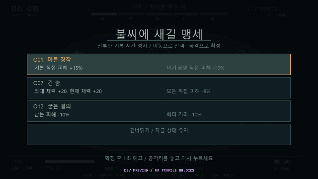

# THE ONE M4 개발 결과

이 문서는 M4 완료 당시의 기록이다. 현재 표현·설정·조정 수치는 [M5 개발 결과](07_M5_STATUS.md)와 README를 따른다.

2026년 10월 16일, Godot **4.5.2.stable.official.6ce3de25a**, GDScript, Windows에서 구현·검증했다. 전투는 기존 60Hz와 같은 경기장·무저 5페이즈를 유지한다.

## 실행과 조작

```powershell
powershell -ExecutionPolicy Bypass -File tools\run_game.ps1
```

WASD/방향키 이동, J 공격, Space/K 회피, Esc 일시정지, R 같은 시드 재도전, F1 판정 표시다. 패드는 왼쪽 스틱·서쪽 버튼 공격·남쪽 버튼 회피·Start 일시정지를 유지한다. 메뉴는 위·아래로 선택하고 J/Enter 또는 서쪽 버튼으로 확정한다.

타이틀에서 정식 도전·잔향 연습·시작 무기·시드·설정을 선택한다. 처음에는 잿빛 검만 시작 무기로 고를 수 있다. 정식 제단에서 교환한 무기는 다음 도전부터 선택할 수 있다. 시드는 숫자와 Backspace로 편집하며 새 시드 생성도 제공한다.



## 구현 범위

| 기능 | 구현 |
|---|---|
| 무기 5종 | 잿빛 검·첫 가시창·쌍생 송곳·묘비 망치·척추 사슬의 기본·비기·4속성·공명 |
| 무기별 시간 | 설계의 준비/실행/회복·회피 취소 틱. 변형 공격도 같은 무기 시간 유지 |
| 쌍단검 | 5·10틱 각각 7 피해, 타격별 중복 금지, 행동당 스택·속성 부가 효과 한 번 |
| 사슬 | 안쪽 22px 궤적 제외, 모든 변형에서 발점 거리 36px 미만 사각 유지 |
| 제단 4개 | 시드별 네 무기 배치. 14px 안에서 입력 없이 대기 33틱, 교환 진행 표시 |
| 교환 원자성 | 틱 끝에 확정, 같은 틱 피격·공격·회피·이동 시 취소. 기존 무기는 제단에 남음 |
| 교환 자원 | 스택 초기화, 체력·보유 기운 보존. 20px 밖으로 나가야 같은 제단 재활성화 |
| 각인 12종 | 이점·부담, 곱연산, 배타·중복 제외, 최대 세 개 |
| 선택 전환 | P1·P2·P3 종료 후 세 후보 또는 건너뛰기. 시간 무제한, 선택 후 60틱 재개 예고 |
| 시드 | layout·boss·oath·element·cosmetic의 독립 스트림. 같은/새 시드 재도전 |
| 연습 | 발견한 시작 무기, 해당 페이즈 제단·기운 사용. 새 발견·해금·정식 기록 차단 |
| 프로필 | 설정·발견 무기·도달 페이즈·본 패턴·최근 정식 기록 100개·별도 최고 승리 기록 |
| 기본 설정 | 장식 파티클, 전체 화면, 개발 판정 표시. 변경 즉시 저장 |

망치 비기의 중심은 발점에서 전방 32px, 반경은 24px로 정했다. 번개를 쓰면 중심이 20px 더 전진한다. 원래 문서에 중심 거리가 없어서 이 값을 정의했고 게임 설계서에도 기록했다. 다른 무기의 피해·시간·사거리·스택과 각인 수치는 원본 설계를 따른다.

각인 O03/O04의 40px 조건은 타격 순간의 발점 거리로 계산한다. 다른 공격 계수와 무기 정의·방향·시간은 시작 시 복사한다. 화염 지속 피해는 직접 피해 각인의 영향을 받지 않는다. O02/O10은 현재 스택을 보존하고 새 임계치로 준비 여부를 다시 판단한다. O08 선택은 기운을 즉시 생성하지 않으며 O11은 이번 전환에서 이미 받은 회복을 소급 변경하지 않는다.

각인 선택·일시정지 중 전투 틱과 플레이 시간은 멈춘다. 히트스톱은 전투 틱을 멈추고 실제 플레이 시간에는 포함한다. 선택 확인을 누른 채 기다려도 재개 후 공격하지 않으며, 놓고 새로 눌러야 한다.

## 저장 범위와 복구

`user://profile.json`의 schema 1을 사용한다. 런처 사용 시 사용자 파일은 `.tools/runtime-data/roaming/Godot/app_userdata/` 아래 게임 폴더에 생성된다. 다른 사용자 데이터 경로로 엔진을 직접 실행하면 별도 프로필을 사용한다.

1. 임시 `.tmp`에 기록한 뒤 다시 읽어 검증한다.
2. 기존 정상 파일을 별도 임시 파일을 거쳐 `.bak`에 보존한다.
3. 원본 파일을 먼저 삭제하지 않고 검증한 임시 파일로 교체한다.
4. 원본 손상 시 정상 백업, 둘 다 사용할 수 없으면 안전한 기본값으로 복구하고 안내한다.

알 수 없는 무기·각인·패턴 ID, 지원하지 않는 스키마, 잘못된 타입·비정상 수치를 검사한다. 새 프로필이 없을 때만 기존 `m3_practice.json`의 최고 도달 페이즈를 이전한다. 정상 백업에서 복구한 뒤 저장해도 손상 원본이 정상 백업을 덮지 않게 한다.

정식 발견·본 패턴·도달은 발생 시 저장한다. 정식 승리·사망·중단을 구분하며 재시도나 결과 대기로 같은 기록이 중복되지 않는다. 최고 승리 기록은 최근 100개 밖으로 밀려도 유지한다. 창 닫기로 진행 중 도전을 끝내면 중단 기록을 남긴다.

**진행 중 전투의 이어하기는 저장하지 않는다.** 이는 설계의 제외 범위다. 체력·기운·각인·보스 상태는 재도전할 때 초기화되며, 발견·연습 해금과 기록은 남는다. 연습·시제품·개발용 직접 진입은 정식 진행을 만들지 않는다.

## 검증 명령

```powershell
powershell -ExecutionPolicy Bypass -File tools\test_all.ps1
```

프로젝트를 한 번 import한 뒤 모든 규칙 검사와 정상 입력 완주를 실행한다. `-SkipPlaythrough`는 아래의 규칙 검사만 실행한다. 각 엔진 실행의 종료 코드와 오류 로그를 모두 검사한다. 로그는 `.tools/runtime-data/validation/`에 남는다.

| 검사 스크립트 | 검사 수 | 주요 확인 |
|---|---:|---|
| combat_tests.gd | 103 | 기존 입력·검·회피·화염·시제품 종료 |
| m3_tests.gd | 319 | 페이즈·4속성·패턴·동시 종료. 각인 선택은 명시적으로 건너뜀 |
| scene_integration.gd | 58 | 실제 장면 입력·히트스톱·선택 정지·재개·결과 |
| pattern_safety.gd | 840 | 23개 시작 상태, 197개 연속 경로, 72,745틱 위험 판정, 허용 회피 거리 4종 |
| m4_combat_tests.gd | 447 | 무기 50개 공격 변형, 타격·스택·각인·제단·난수 |
| profile_tests.gd | 81 | 실제 파일 저장·백업·손상·저장 실패·ID·스키마·M3 이전 |
| m4_review_tests.gd | 62 | 독립 검토의 중도 취소·거리 경계·스냅샷·제단 마지막 틱 |
| m4_integration.gd | 23 | 장면 재생성으로 발견·기록·설정 복원, 선택과 전체 저장 연결 |
| m4_ui_boundary.gd | 10 | 메뉴 복귀·새 시드·DEV 차단·창 닫기 기록 |
| 합계 | **1,943** | **실패 0** |

희귀 경계 검사는 위치·체력 등을 배치해 원인을 분리한다. 아래 완주 검증은 이동·공격·회피와 실제 제공된 각인 후보의 선택만 전달한다. 체력·피해·위치·기운·스택·페이즈 주입, 무적 설정을 사용하지 않는다. 시작 체력은 100이며, 각인이 정하는 최대 체력 변화와 전환 회복만 적용한다.

| 시작 무기 / 시드 7 | 결과 | 전투 틱 | 종료 체력 | 선택 각인 |
|---|---|---:|---:|---|
| W01 잿빛 검 | 승리 | 42,277 | 85 | O05·O06·O04 |
| W02 첫 가시창 | 승리 | 51,502 | 120 | O07·O08·O04 |
| W03 쌍생 송곳 | 승리 | 37,064 | 100 | O03·O01·O10 |
| W04 묘비 망치 | 승리 | 59,464 | 110 | O07·O08·O11 |
| W05 척추 사슬 | 승리 | 54,534 | 100 | O05·O12·O04 |

다섯 실행 모두 P1→P2→P3→P4→P5, 보스 총 피해 6000과 15패턴을 확인했다. 이 검사 외에 기존 P1 정상 입력 5개 시드와 무각인 검의 전체 전투 3개 시드를 회귀 실행했다. 소수 피해 합계의 비교에는 전투의 0.001 단위 반올림을 고려한 0.002 오차를 사용한다.

실제 Godot OpenGL 창에서 무기·시드·설정·각인 선택과 제단·W05 HUD를 실행하고 캡처해 한국어와 배치를 확인했다. 위 이미지가 해당 실행에서 나온 결과다.

## 파일과 책임

| 파일 | 역할 |
|---|---|
| data/weapons.json | 무기별 피해·타격 이벤트·시간·범위·비기 |
| data/oaths.json | 각인의 이점·부담·수치·배타 목록 |
| scripts/combat_model.gd | 무기 스냅샷, 각인 계산, 제단 교환, 선택 정지, 독립 난수 |
| scripts/combat_geometry.gd | 판정·그리기가 공유하는 기하, 사슬의 안쪽 사각 |
| scripts/profile_store.gd | 프로필 검증·원자적 교체·백업·복구·이전 |
| scripts/main.gd | 입력·메뉴·표시·저장 이벤트·실시간 기록 |
| tools/test_all.ps1 | 전체 검증 실행과 실행별 로그·오류 확인 |

기존 `data.sword`는 W01 정의의 호환 별칭이며 별도 수치 원본이 아니다. `reset(seed, mode, phase, starting_weapon)`으로 도전을 시작한다. 개발용 `--practice=N`, `--weapon=W0N`, `--dev-screen=oaths` 등의 직접 진입은 DEV로 표시하고 정식 해금·기록을 차단한다.

## 아직 확인하지 못한 내용과 M5

사람이 물리 키보드·패드로 다섯 무기를 각각 완주하는 테스트, 실제 게임패드 기기별 호환, 여러 GPU의 성능 측정은 수행하지 않았다. 자동 정책은 예고에서 계산한 경로를 따라가므로 사람의 학습 난도나 재미를 검증한 결과가 아니다.

안전하게 회복 구간을 기다리는 자동 정책의 순수 전투 시간은 약 10분 18초~16분 31초다. 히트스톱을 포함한 사람의 실측 시간과 무기 균형은 추가 조정이 필요하다. 8~12분 목표를 달성했다고 보고하지 않는다.

다음 M5에서 최종 도트와 방향별 애니메이션, 음향과 예고음, 키 재지정·접근성 옵션, 본 패턴 도감 표시, 사람 대상 난도·무기 균형 조정, 다양한 화면 비율과 성능 검증을 진행한다. 현재 저장된 발견·본 패턴 데이터를 해당 화면에 연결하고 프로필 스키마 변경이 필요하면 이전 경로도 함께 검증한다.
