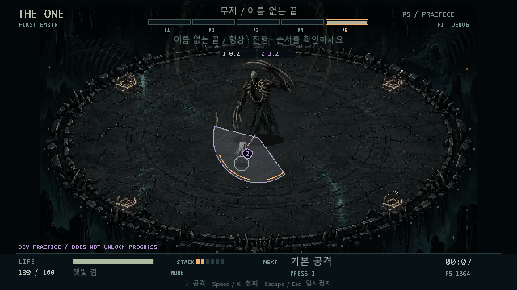

# THE ONE M5 개발 결과

2026년 10월 16일. Godot **4.5.2.stable.official.6ce3de25a**, GDScript, Windows에서 M5의 표현·음향·도감·조작 설정과 무기 수치 조정을 구현했다. 한 경기장·한 보스·다섯 페이즈·60Hz 전투와 기존 자원 규칙을 유지했다.

## 실행

```powershell
powershell -ExecutionPolicy Bypass -File tools\run_game.ps1
```

기본 조작은 WASD/방향키 이동, J 공격, Space/K 회피, Esc 일시정지, R 같은 시드 재도전이다. 패드는 왼쪽 스틱·서쪽 공격·남쪽 회피·Start 일시정지다. 설정의 조작 재지정에서 바꿀 수 있다. 메뉴는 방향키·Enter·Esc로 항상 복구할 수 있다.

런처는 실행 전 텍스처·음향을 import하므로 `.godot` 캐시가 없는 소스 체크아웃도 준비한다. 다른 컴퓨터에서는 Godot 4.5.2 Standard를 준비하고 `-GodotPath`를 지정한다. 편집기는 `-Editor`, 준비된 캐시로 바로 실행할 때는 `-SkipImport`를 사용할 수 있다.



## 도트와 애니메이션

[EITR 공식 소개](https://store.steampowered.com/app/350050/EITR/)의 등각 표현과 어둡고 축축한 분위기를 참고해 창세 이전의 재·검은 뼈·불씨로 별도 자산을 만들었다. 기존 게임의 그림·음악 파일을 가져오지 않았다.

- 실제 래스터 경기장, 인간 40포즈, 무저 18포즈, 무기·제단·기운 10스프라이트를 사용한다.
- 인간은 북·북동·동·남동·남 원본과 반전으로 8방향을 표시한다. 이동 보폭, 공격 준비/실행/회복, 회피, 피격과 사망 동작을 연결했다.
- 무기는 별도 레이어다. 창은 고정한 방향으로 찌르고, 망치는 내려치며 검·쌍단검·사슬은 휘두른다. 실제 무기의 시간과 공격 스냅샷을 읽는다.
- 보스 공통 몸체를 재사용하고 페이즈별 흉부·서리·잔향·정지 실루엣을 조합한다. 최종 처치에는 붕괴 동작을 보여 준다.
- 640×360·최근접 필터·정수 배율을 유지한다. 발밑 그림자는 지면 좌표를 표시하고 큰 몸체가 새로운 판정을 만들지 않는다.
- 예고와 피해는 기존의 동일 기하를 공유한다. 장식 파티클은 배우와 위험 예고 아래에 둔다.
- 효과 줄이기는 피격 밝기 깜박임·회피 잔상·사망 파편·장식 박동을 억제한다. 필수 표식과 기운 도형은 남긴다.

실제 화면에서 좌우 반전 시 음수 사각형 때문에 배우가 발점에서 48/104px 밀리는 결함을 발견했다. 로컬 transform 반사로 바꾸고 실제 GPU 프레임버퍼의 경계·중심·픽셀 수를 검사했다. 움직임·전투 애니메이션은 전투 시간, 전투 종료 뒤의 쓰러짐은 UI 시간으로 갱신한다.

P5 파동과 경기장이 접하는 순간, 클리핑된 0.002px² 삼각형의 좌표 곱이 상쇄되어 Godot가 점 순서를 잘못 해석하는 렌더 오류도 수정했다. 해당 삼각형의 순서만 바로잡아 좌표·면적·피해 판정을 보존했다. 15패턴×3배치의 전체 12,566틱에서 158,352개 클리핑 조각이 모두 삼각분할 가능한지 검사했다.

원본 PNG, 내장 `image_gen.imagegen` 사용과 전체 생성·수정 프롬프트는 [아트 제작 기록](../assets/art/README.md)에 있다. 런타임은 임포트된 텍스처를 사용하며 생성 도구의 외부 저장 경로에 의존하지 않는다.

## 음향

원본 음악 5개와 효과음 27개, 총 **32개 stereo PCM WAV**를 연결했다. 음악은 각각 16초 루프다. P1의 돌과 북, P2 균열, P3 심장음, P4 시간차 응답, P5 악기를 줄인 숨결로 구분한다.

공격 버튼을 누른 시각에 적중음을 추측하지 않는다. 실제 무기의 타격 틱과 위험 이벤트의 예고·방향 확정·실행·잔향 시각을 읽는다. 쌍단검 두 타격은 두 번, 같은 판정이 겹치는 프레임은 한 번만 울린다.

전체·음악·효과음 음량과 음악/효과음 음소거를 저장한다. 음악을 꺼도 예고음은 남고, 모든 소리를 꺼도 지면 표식은 남는다. 전투 소리는 일시정지·선택·히트스톱과 함께 멈추며 메뉴 확인음은 동작한다. 최대 8개 효과음과 정규화한 음악 혼합의 최악 PCM 피크는 0.65FS 미만으로 제한했다.

[음향 제작 기록](../assets/audio/README.md)과 `tools/generate_audio.py`에 합성 소스·파형 메타데이터·제작 경위가 있다. 사람의 청취 품질 검증과 수학적 클리핑·타이밍 검증은 구분한다.

실제 창 종료에서 드러난 오디오 참조 잔류도 수정했다. Godot의 `stop()` 뒤에는 오디오 스레드와 메인 루프의 정리가 필요하다. 종료 시 이를 비동기로 기다리고 자원을 해제한다. 일시정지 중 새 확인음까지 재생한 조건에서 실제 재생 객체와 PCM의 약한 참조가 종료 전에 사라지는지 검사했고, 네이티브 화면 비율·프레임 상한 다섯 실행도 오류 없이 종료했다.

## 도감·조작·저장

불씨의 기록은 무기·기운·각인·무저의 기억 네 분류다. 정식에서 발견한 무기와 마주친 패턴만 공개한다. 같은 패턴을 정식에서 두 번 이상 맞으면 대응 원리를 보여 준다. 연습은 새 해금이나 피격 경험을 만들지 않는다. 타이틀과 일시정지에서 읽을 수 있고 위·아래·Tab·좌우·패드 D-pad/LB/RB로 조작한다.

키보드 이동 4방향·공격·회피·일시정지, 패드 공격·회피·일시정지 버튼을 재지정한다. 중복·예약 키는 거절하고 취소와 기본값 복원을 제공한다. 스틱 데드존은 10~60%다. 재지정 확인이나 메뉴 확인 입력을 전투 공격으로 넘기지 않는다.

기존 schema 1 프로필을 보존하며 새 설정·패턴별 피격 경험·실제 속성 사용 횟수를 확장했다. JSON의 키코드 숫자는 정수로 복구한다. 공명도 해당 속성을 한 번 쓴 것으로 기록한다. 엔딩 표식·칭호는 현재 무기와 가장 많이 사용한 속성으로 정하고 동률은 화염→서리→번개→공허 순서다. 진행 중 도전의 이어하기는 기존 설계대로 저장하지 않는다.

연타 사망 원인에는 패턴 이름과 몇 번째 타격/잔향인지를 표시한다. 패턴 식별자는 그대로 유지해 도감의 피격 경험과 연결한다.

## 무기 밸런스

보스 체력 합계 6000, 보스 피해·예고·회복·회피 무적·공격 시간·사거리·스택은 유지했다. 실제 보스의 공격 틈에서 긴 무기의 한 번과 빠른 무기의 여러 번이 만드는 차이를 보정하기 위해 직접 피해만 다음처럼 조정했다.

| 무기 | M4 기본 피해 | M5 기본 피해 | 무각인 3개 시드 평균 | 범위 |
|---|---:|---:|---:|---|
| 잿빛 검 | 18 | 18 | 11분 25초 | 10분 20초~12분 |
| 첫 가시창 | 22 | 27 | 10분 34초 | 10분~11분 38초 |
| 쌍생 송곳 | 7+7 | 7.5+7.5 | 11분 23초 | 10분 36초~11분 47초 |
| 묘비 망치 | 32 | 44 | 11분 19초 | 11분 9초~11분 34초 |
| 척추 사슬 | 19 | 27 | 10분 51초 | 10분 31초~11분 18초 |

시드 1/2/7, 시작 체력 100, 각인 없음, 같은 보수적인 입력 정책으로 **15회 모두 승리**했다. 새로운 누름·이동·회피와 실제 기운 수집만 사용하며 체력·피해·자원·위치·페이즈를 테스트 중 주입하지 않는다. 피해 조정은 게임 데이터에 적용된 실제 수치이며 테스트 전용 보정이 아니다.

시간은 메뉴를 제외하고 **60fps 히트스톱을 포함해 환산한 전투 시간**이다. CPU가 빠르게 계산한 테스트 실행 소요 시간과 다르다. 실제 장면에서도 재지정한 키보드 이벤트와 패드 이벤트를 끝까지 전달해 각각 719.350초·619.500초로 승리했다. 이는 Godot 입력·장면·히트스톱 연결 검사이며 사람이 물리 기기로 플레이했다는 뜻은 아니다.

M4의 동일 시드 7 비교는 창 약 13분 12초, 망치 15분 48초, 사슬 15분 43초였다. 조정 후 전체 무각인 비교 범위는 약 **10~12분**이다. 각인을 선택한 무기별 완주도 별도로 회귀 실행했다. 한 시드에서 기운 획득 0·각인 없음의 검으로도 723.167초에 무피격 승리했다. 기운은 필수 열쇠가 아니다.

원자료: [M4 기준](validation/m4-baseline.json), [M5 15회 비교](validation/m5-balance.json), [기운 미획득](validation/m5-no-pickups.json). 수치 원본은 `data/weapons.json`이고 설계서에도 같은 값을 반영했다.

## 난도와 검증 범위

가만히 있는 정책과 예고 초반에 너무 일찍 회피하며 공격을 반복하는 정책을 5무기×2시드로 실행했다. **20회 모두 P1에서 4회 피격 후 사망**했다. 올바른 대응의 무피격 경로는 기존 840개 안전 검사로 확인했다. 무기 수치 조정으로 예고를 무시하고 이기도록 만들지 않았다.

[피격 정책 원자료](validation/m5-difficulty.json)는 실패 시각·패턴·피해를 남긴다. 이 비교는 예고와 거리·타이밍 대응이 필요함을 확인하며, 사람의 첫 클리어 난도·학습 곡선·재미·액션 숙련도 차이를 추정하지 않는다.

자동 규칙·자산·UI 검사는 **2,806개**, 실제 GPU 반전 검사는 **32개**, 합계 **2,838개 / 실패 0**이다. 정상 입력 완주와 피격 정책 실행은 이 검사 수와 별도다.

| 검사 | 개수 |
|---|---:|
| 기존 전투·M3·장면·안전·M4·프로필·저장 연결 | 1,943 |
| 도트 프레임·알파·방향·무기 애니메이션·효과 줄이기 | 290 |
| 전체 패턴의 렌더 조각·접점 오류·좌표와 면적 보존·캐시 격리 | 133 |
| 실제 PCM·헤드룸·음소거·타격·15패턴 큐·정지·종료 | 370 |
| 도감·재지정·복구·저장·속성 사용·엔딩 | 58 |
| 실제 연타·잔향의 구체적인 피해 원인 | 8 |
| 일시정지 중 창 닫기·중복 저장 방지·입력 차단·음향 정리 | 4 |
| 실제 GPU의 반전 경계·중심·픽셀 수 | 32 |

```powershell
powershell -ExecutionPolicy Bypass -File tools\test_all.ps1
powershell -ExecutionPolicy Bypass -File tools\test_native.ps1
```

첫 명령은 헤드리스 규칙 검사와 전체 완주·무기 비교다. `-SkipPlaythrough`로 장시간 완주를 제외할 수 있다. 빠른 UI/입력 시뮬레이션에서는 물리 믹서 재생을 끄고 큐를 확인한다. 별도 오디오 검사와 실제 창에서는 실제 AudioStreamPlayer를 검증한다.

두 번째는 실제 창을 열어 GPU 반전 검사, 실제 음향을 재생한 창 닫기, 30/60/120fps·다른 화면 비율과 P5 장판·파동 샘플을 실행한다. GPU 없는 헤드리스 성능으로 대체하지 않는다. 원시 로그는 `.tools/runtime-data/validation/`, 네이티브 샘플은 `.tools/runtime-data/performance/`에 남는다.

## 네이티브 성능

Intel Core Ultra 5 125H / Intel Arc Graphics / OpenGL Compatibility / Windows build 26300 / 드라이버 32.0.101.9150에서 실행했다. 2초 예열 후 기본 조건은 각 5초, P5 장판·파동은 8초를 표본으로 삼았다. 프레임 간격은 Godot의 평활화된 delta 대신 단조 시계로 측정했다.

P5 부하 검사에서 같은 장판과 예고 도형을 매 프레임 다시 클리핑하는 비용을 확인했다. 정확한 기하 파라미터를 비교하는 128개 제한 캐시를 추가했다. 해시가 같아도 파라미터가 다르면 새로 계산하고, 각 꼭짓점 버퍼를 복제해 호출자의 수정이 캐시에 전파되지 않게 했다. 같은 엔진 프로세스의 실제 P5 도형 10,500회 비교에서 CPU 계산은 1,528.882ms→106.554ms로 줄었다. 이 14.35배는 해당 계산의 개선량이며 게임 전체 FPS 배수가 아니다.

| 창 크기 | 렌더 상한 | 평균 프레임 | p95 | 논리 전장 |
|---|---:|---:|---:|---|
| 1280×720 | 30fps | 33.33ms | 34.24ms | 640×360 |
| 1280×720 | 60fps | 16.66ms | 17.00ms | 640×360 |
| 1280×720 | 120fps | 8.33ms | 9.06ms | 640×360 |
| 1024×768 | 60fps | 16.67ms | 16.85ms | 640×360 |
| 1920×720 | 60fps | 16.67ms | 16.95ms | 640×360 |
| 1280×720 / P5 장판·파동 | 60fps | 16.67ms | 17.05ms | 640×360 |

P5 표본은 8초 동안 480프레임, p99 18.74ms, 최장 22.31ms였다. 초기 최적화 전 표본의 p95 25.33ms도 원자료에 남겼다. 재실행마다 시스템 부하 차이가 있으므로 프레임 차이 전체를 캐시의 효과로 단정하지 않는다. 계산 비용 개선은 위의 같은 프로세스 비교로 별도로 확인했다.

화면 비율이 바뀌어도 전장을 넓히거나 자르지 않았다. 물리는 계속 60Hz이며 전투 틱은 히트스톱 동안 멈춘다. 이 수치는 해당 장치와 짧은 표본의 결과이고 여러 GPU나 전체 전투 장시간 프레임 보장은 아니다. [표본 원자료](validation/m5-performance.json)에 환경과 프레임·물리 모니터를 기록했다.

## 남은 사람 대상 평가

사람이 물리 키보드·패드로 다섯 무기를 완주하는 관찰, 여러 패드 기기, 헤드셋/스피커의 음질·음량 체감, 액션 경험이 다른 테스터의 첫 30분 학습은 수행하지 않았다. 자동 정책은 예고에서 계산한 안전 경로를 쓰므로 인간의 판단 지연을 포함하지 않는다.

다음 검증은 실제 테스터의 무기별 공격 기회·기운 수집·클리어 시간·사망 원인 이해를 기록하고, 효과 줄이기·음악 끔·전체 음소거 조건에서 같은 패턴을 읽는지 비교하는 것이다. 다른 GPU의 장시간 성능과 배포 빌드 확인도 이 결과와 구분해 진행한다.
